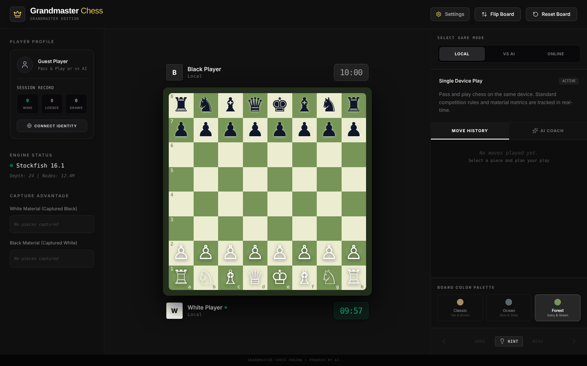
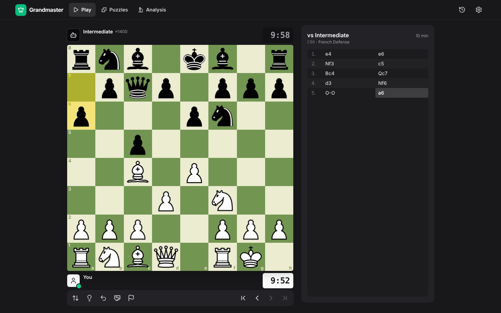
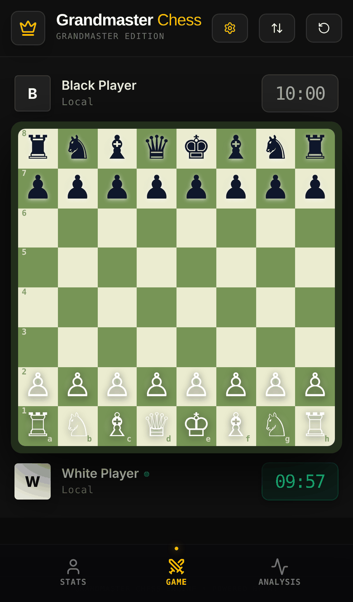
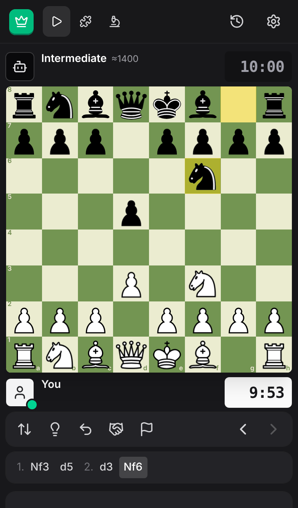
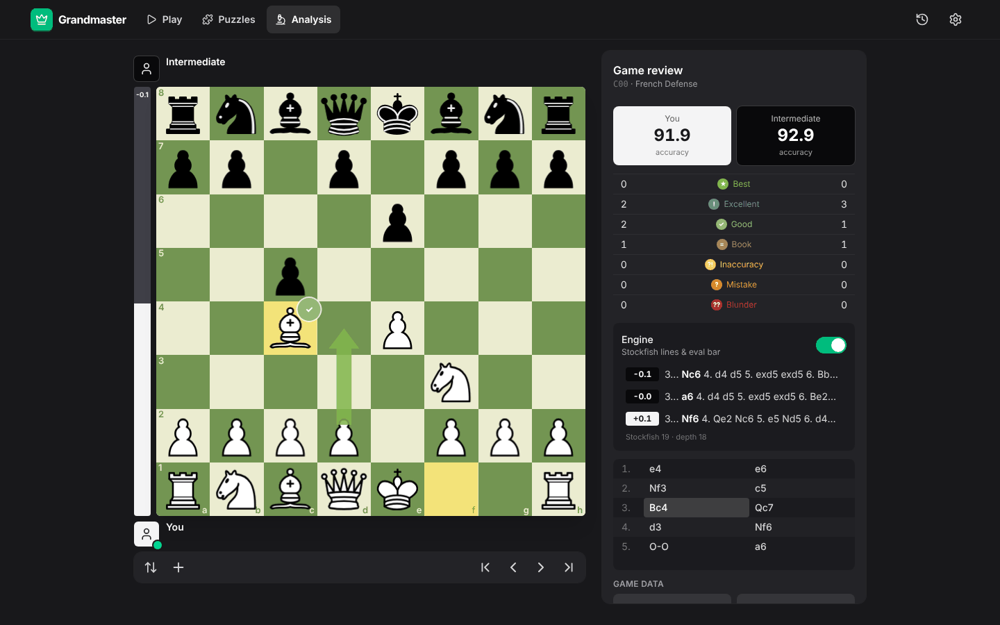
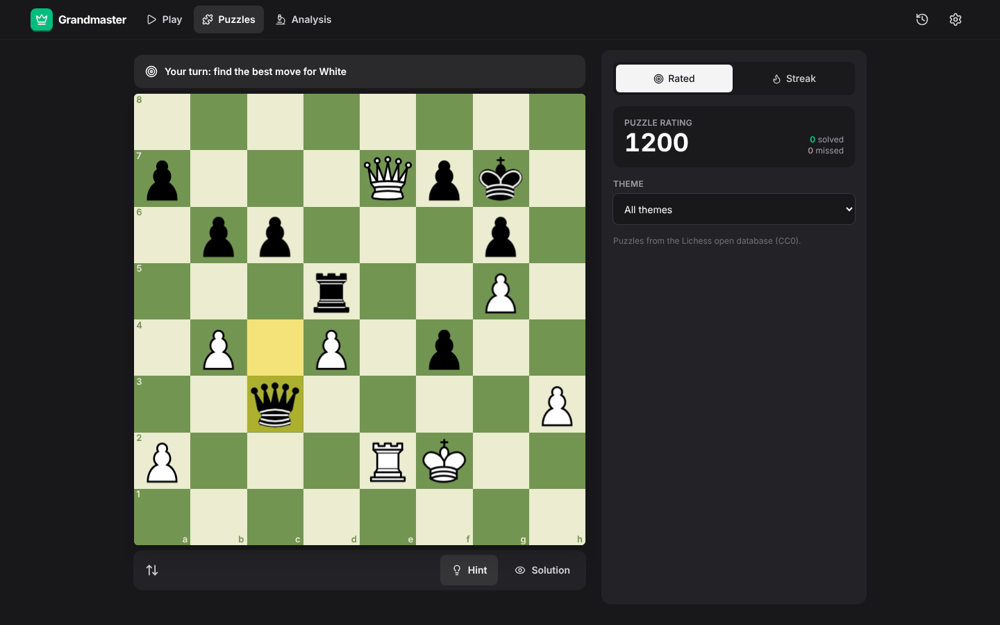
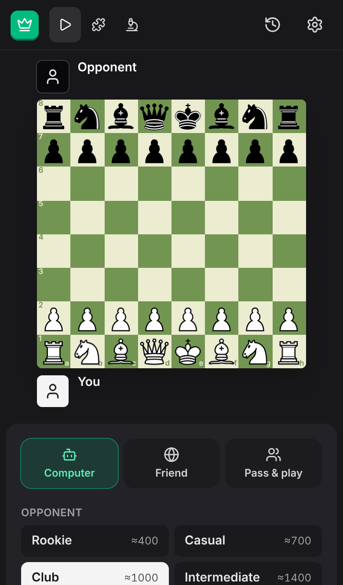
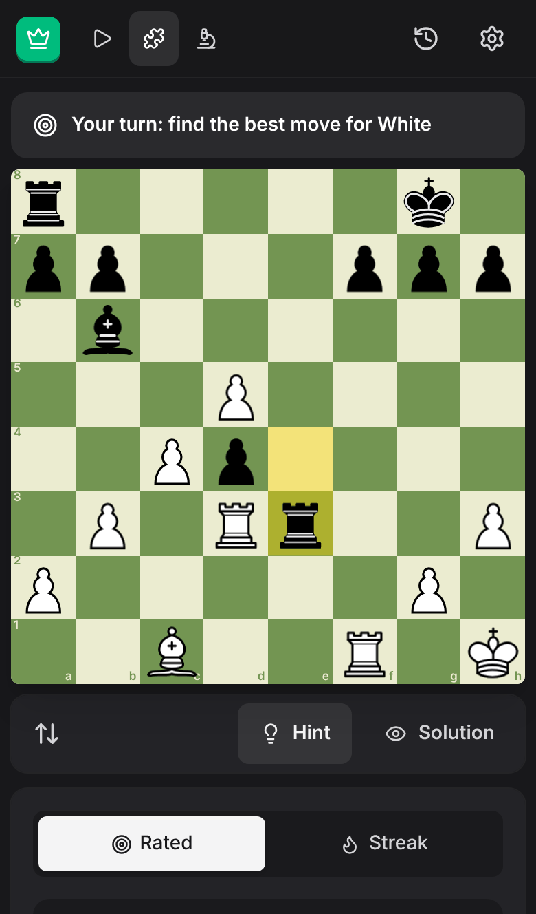
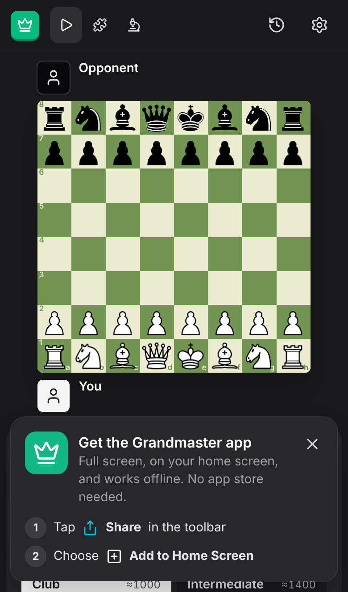

# Grandmaster Chess

A full-stack chess app with React and Node. You can play Stockfish bots, play a friend online, or play two people on one device. After a game you get a Chess.com-style game review, an analysis board, and an optional AI coach (Gemini). It works on desktop and mobile, and you can install it to the home screen.

## Screenshots

### Before and after

| | Before | After |
|---|---|---|
| **Desktop** |  |  |
| **Mobile** |  |  |

The old version used Unicode piece glyphs, a fixed 10-minute clock and three crowded columns. The new version puts the board first, with SVG pieces, a move strip, and touch-friendly controls on phones.

### New features

| Game review | Puzzles |
|---|---|
|  |  |

| New game (mobile) | Puzzles (mobile) | Install as an app |
|---|---|---|
|  |  |  |

## Features

**Play**
- **vs Computer:** eight bot levels from about 400 Elo to full-strength Stockfish 19. Stockfish runs as WASM in a Web Worker, so the UI never freezes.
- **Play a friend online:** create a game, share the link or the 6-character code, and play in real time over WebSockets. Spectators can watch. Includes draw offers, resign, rematch (with colours swapped), automatic reconnect, and abandonment detection.
- **Pass & play:** two players on one device.
- **Time controls:** bullet, blitz, rapid, classical and unlimited, with increments. Clocks start after each side's first move. The low-time warning beeps. A flag fall is scored as a draw when the opponent can't mate.
- **Full rules via `chess.js`:** castling, en passant, promotion with a piece picker, check and mate, stalemate, threefold repetition, the 50-move rule and insufficient material.

**Board UX**
- Move by dragging or tapping (touch-safe, no page scroll while dragging).
- Legal-move dots, last-move and check highlights, and slide animations.
- Right-click and drag draws arrows; right-click marks a square.
- Keyboard: `←` `→` `Home` `End` step through moves, `F` flips the board.
- Five board themes, the cburnett SVG pieces, and synthesized sounds (no audio files).

**Puzzles**
- About 4,000 rated tactics puzzles from the Lichess open database (CC0), checked for legality and spread across ratings from 400 to 2700.
- **Rated mode:** your puzzle rating adjusts after every puzzle. You can filter by theme (mate in 1/2/3, fork, pin, skewer, sacrifice, endgame and more).
- **Streak mode:** puzzles get harder each time, and one mistake ends the run. Your best streak is saved.
- Hint, retry, show solution, and "Analyse this puzzle" on the analysis board. Any checkmating move is accepted, even if it differs from the stored solution.

**Accounts and online multiplayer**
- **Sign in the usual way:** Continue with Apple or Continue with Google, or create an account with email (with a "Log in" link for returning email users). Apple and Google create the account automatically on first use, and an Apple or Google sign-in links to an existing email account with the same verified address. Online play requires an account; everything else works as a guest.
- **Quick match:** pick a time control (bullet, blitz or rapid) and get paired with the closest-rated player waiting for the same game. These games are **rated** (Elo, starting at 1500). Games aborted before both players move don't count.
- **Play a friend:** create a casual game and share the link or code. Anyone without an account who opens the link can watch as a spectator.
- Your rating, win/draw/loss record, puzzle rating and game history sync across devices.
- **Security:**
  - Passwords are hashed with scrypt.
  - Login errors don't reveal which emails exist, and repeated failures are locked out for 15 minutes.
  - Sessions use a random token in an httpOnly, SameSite=Lax cookie, stored server-side only as a SHA-256 hash.
  - Google ID tokens are verified with `google-auth-library`.
  - Apple ID tokens are verified against Apple's public keys (`jose`), with a one-time nonce bound to the browser to stop token replay.

**Improve**
- **Game review:** every move is classified (Book, Best, Excellent, Good, Inaccuracy, Mistake, Blunder) with Lichess-style accuracy, an evaluation graph and best-move arrows.
- **Analysis board:** eval bar and the top three Stockfish lines. You can import PGN or FEN, and export PGN or FEN.
- **Hints and takebacks** against bots.
- **Game archive:** your last 50 games, plus win/draw/loss stats against the computer.
- **AI Coach:** Gemini explains the position. It is grounded in the engine evaluation, and the server replays and validates every move before calling the model.
- A game in progress survives a page reload.

## Architecture

```
server.ts               Express + WebSocket server (dev: Vite middleware, prod: static dist/)
server/rooms.ts         Authoritative online games and matchmaking: validates moves, runs clocks, rates games
server/coach.ts         /api/coach: Gemini with structured JSON output, rate-limited
server/auth.ts          Email/password + Google sign-in, sessions, CSRF/origin checks, progress sync
server/db.ts            Tiny JSON-file store (atomic writes). Swap for Postgres/MongoDB when you outgrow it
public/puzzles/         Curated puzzle set (CC0)
shared/protocol.ts      Typed client/server message protocol
shared/rules.ts         Result detection shared by client and server
src/engine/             Stockfish UCI client (Web Worker), bot levels, game review
src/store/              Zustand stores: game, online, settings, ui
src/components/board/   Board (pointer events, arrows, promotion), piece assets
src/components/…        Player bars, clocks, eval bar, move list, panels, dialogs
public/engine/          Stockfish 19 lite (single-threaded WASM, ~1.8 MB)
```

**Design decisions**
- **The server is the referee.** Clients send move *intents*. The server checks each one with `chess.js` and broadcasts the result. A client can't make an illegal move, move out of turn, or change the clocks.
- **Single-threaded Stockfish build.** It needs no special headers (COOP/COEP), so it runs on any static host and on iOS Safari.
- **No accounts.** You choose a display name. A random player ID stored on your device reclaims your seat if you reconnect. Real sign-in (OAuth) can be added later without changing the game protocol.

## Running

```bash
npm install
npm run dev        # http://localhost:3000
npm run lint       # type-check
npm run build && npm start   # production
```

Optional features. Copy `.env.example` to `.env`, then:
- **AI Coach:** set `GEMINI_API_KEY`.
- **Google sign-in:** set `GOOGLE_CLIENT_ID`. To get one:
  1. In Google Cloud Console, go to **APIs & Services → Credentials → Create credentials → OAuth client ID** and choose **Web application**.
  2. Under **Authorized JavaScript origins**, add `http://localhost:3000` and your production URL. No client secret or redirect URI is needed.
  3. Set up the OAuth consent screen (app name and support email).

- **Sign in with Apple:** set `APPLE_CLIENT_ID` and `APPLE_REDIRECT_URI`. This needs a paid Apple Developer account:
  1. In Certificates, Identifiers & Profiles, create an **App ID** with *Sign in with Apple* enabled.
  2. Create a **Services ID**. That is your `APPLE_CLIENT_ID`, for example `com.yourname.grandmaster.web`.
  3. On the Services ID, configure *Sign in with Apple*: add your domain and a **Return URL** such as `https://your-domain.com/`. That is your `APPLE_REDIRECT_URI`.

  Apple only accepts HTTPS domains, so Apple sign-in works on your deployed site, not on `localhost`. During development, unconfigured providers show as greyed-out "Dev only" buttons; in production they are hidden.

  Accounts are saved to `data/db.json` (`DATA_DIR`). On hosts with ephemeral disks, such as Cloud Run, mount a volume or move the store to Postgres or MongoDB.

To test on a phone, run `npm run dev` and open `http://<your-computer-LAN-IP>:3000` on the phone.

**Hosting:** online play needs a long-running Node process with WebSocket support, such as Render, Railway, Fly.io or Cloud Run. Serverless platforms that don't support WebSockets (for example Vercel functions) can host everything except online play.

## Licences

- Stockfish is GPLv3. See `public/engine/STOCKFISH-LICENSE.txt`. Serving the unmodified engine binary is fine; if you change it, you must publish the source.
- Puzzles come from the Lichess puzzle database (CC0).
- The cburnett pieces are by Colin M.L. Burnett. See `public/pieces/LICENSE.txt`.
